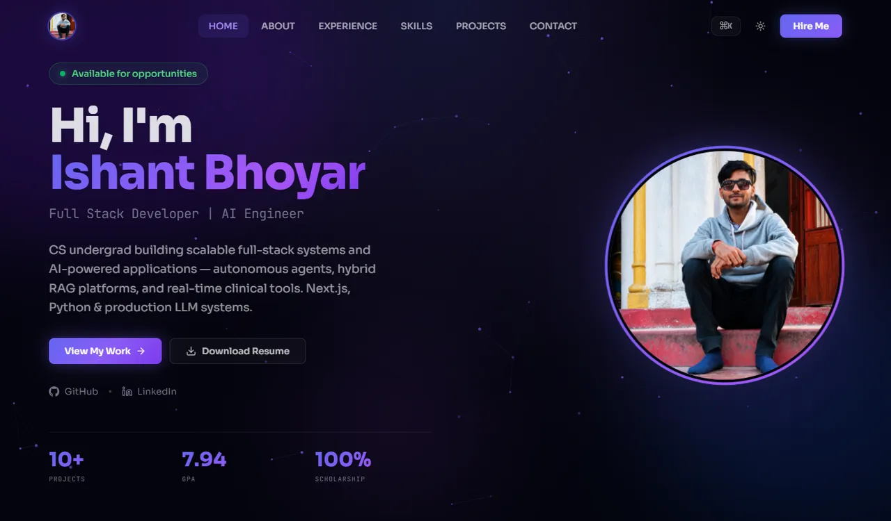
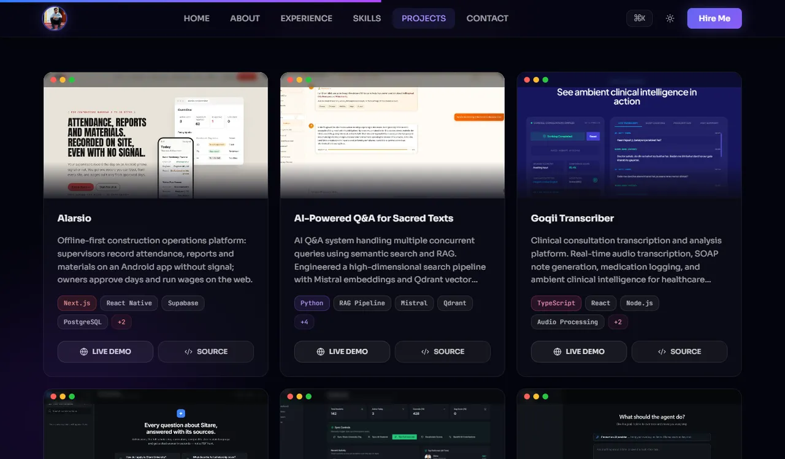

# Ishant Bhoyar — Portfolio

Personal portfolio of a full-stack developer and AI engineer: projects, experience, skills and contact, in a fast single-page site with a dark and a light theme.

**Live site:** https://ishant-portfolio-sxef.onrender.com





## What is on the site

- **Hero, About, Experience, Skills** — who I am, what I have built and the tools I use.
- **Featured project and 12 project cards** — each with a screenshot, tech tags, and links to the live demo or source where they are public. Projects without a public repository or hosted demo say so on the card.
- **LeetCode stats and GitHub repositories** — pulled from public profiles.
- **Command palette** — press `Ctrl/⌘ + K` to jump to any section.
- **Contact form** — handled by the small API server in `artifacts/api-server`.
- **Dark and light themes**, responsive from 320 px phones to wide desktops.

## Built with

| Area | Tools |
| :-- | :-- |
| Front end | React, TypeScript, Vite, Tailwind CSS, Framer Motion, Radix UI |
| Back end | Node.js (Express) in `artifacts/api-server` |
| Tooling | pnpm workspaces, TypeScript project references |
| Hosting | Render (static site); Netlify and Vercel configs are included as alternatives |

## Repository layout

```
artifacts/portfolio     the website (React + Vite)
artifacts/api-server    the contact-form API
artifacts/mockup-sandbox  design experiments
lib/                    shared packages
docs/screenshots/       images used in this README
render.yaml             Render deployment
```

## Run it locally

You need Node.js 20 or newer and [pnpm](https://pnpm.io).

```bash
pnpm install
pnpm --filter @workspace/portfolio run dev        # http://localhost:3000
```

Other useful commands:

```bash
pnpm --filter @workspace/portfolio run typecheck  # TypeScript check
pnpm --filter @workspace/portfolio run build      # production build in artifacts/portfolio/dist/public
pnpm --filter @workspace/portfolio run serve      # preview the production build
```

The build reads two optional environment variables: `PORT` (dev server port, default 3000) and `BASE_PATH` (URL prefix, default `/`).

## Quality checks

The site is checked with [axe-core](https://github.com/dequelabs/axe-core) against WCAG 2.1 A and AA in the default dark theme at desktop and phone width, and has no horizontal scroll at 390 px. Screenshots are WebP, sized for their cards (about 270 KB in total).

## Contact

GitHub [@ISHANT57](https://github.com/ISHANT57) · use the contact form on the live site.
